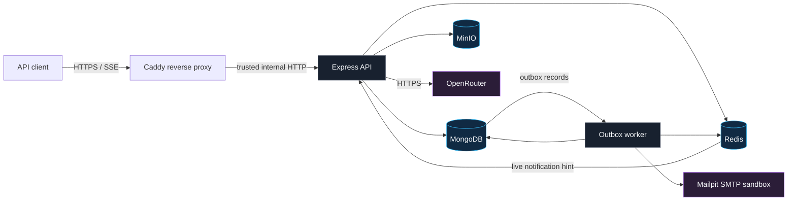

# Task Tracking API

An Express 5 and strict TypeScript backend for collaborative project and task tracking. It includes rotating refresh sessions, project roles, invitations, tasks, comments, private attachments, durable notifications with SSE, OpenRouter-assisted drafts and summaries, and asynchronous invitation email.

## Architecture

The application is a modular monolith. Controllers validate HTTP input, application services own workflows and authorization, domain objects enforce invariants, and infrastructure adapters implement typed ports. MongoDB is the durable source of truth. Redis provides rate limiting and transient notification fan-out. MinIO stores private attachment objects. Mailpit captures local email. A separate worker process handles notification outbox and email delivery jobs.

### Infrastructure at a glance



MongoDB, Redis, MinIO, the API, worker, and Mailpit run in the local Compose environment. OpenRouter is an outbound HTTPS integration, not another locally hosted service. The optional observability profile adds the OpenTelemetry collector, Tempo, Loki, Promtail, Prometheus, and Grafana.

Caddy is the only public entry point in the production Compose overlay. It terminates TLS, forwards REST traffic, and streams SSE without response buffering. MongoDB, Redis, MinIO, Mailpit, the API container, and the worker remain on the private Compose network.

Design details are in [`docs/HLD.md`](docs/HLD.md), [`docs/LLD.md`](docs/LLD.md), [`docs/DATABASE_DESIGN.md`](docs/DATABASE_DESIGN.md), and the consolidated [`docs/DECISIONS.md`](docs/DECISIONS.md).

## Prerequisites

- Docker Desktop with Compose
- Node.js 22 or newer for local tests and development

## Start locally

1. Copy `.env.example` to `.env`.
2. Replace `JWT_SECRET` with a value of at least 32 characters. Leave `OPENROUTER_API_KEY` blank unless exercising live AI calls.
3. Run `docker compose up --build`.
4. Wait for `docker compose ps` to show the API, MongoDB, Redis, MinIO, and Mailpit as healthy or running.

The API root is `http://localhost:3000/api/v1`, readiness is `http://localhost:3000/health/ready`, Mailpit is `http://localhost:8025`, and the MinIO console is `http://localhost:9001`. Compose initializes the MongoDB replica set and private attachment bucket before starting the API and worker.

The optional observability stack starts with:

```sh
docker compose --profile observability up --build
```

It adds an OpenTelemetry collector, Tempo, Loki, Prometheus, and Grafana without making them application dependencies.

For a public deployment, point the domain's A/AAAA record at the server, allow inbound TCP 80/443 and UDP 443, then run `docker compose -f compose.yaml -f compose.prod.yaml up -d --build`. Set `DOMAIN` to the API hostname; Caddy obtains and renews its certificate automatically. See [`docs/DEPLOYMENT.md`](docs/DEPLOYMENT.md) for verification steps.

Set `OTEL_ENABLED=true` before starting the profile to export application traces. Promtail ships container stdout logs asynchronously to Loki. Grafana at `http://localhost:3001` is preconfigured with Loki, Tempo, and Prometheus data sources. MongoDB remains the only source of truth for business state; loss of telemetry does not affect requests or delivery jobs.

## Environment

| Variable | Purpose | Local default/template |
|---|---|---|
| `PUBLIC_URL` | Trusted browser origin and invitation-link base | `http://localhost:3000` |
| `MONGODB_URI` | Replica-set MongoDB connection | Compose MongoDB |
| `REDIS_URL` | Rate limiting, AI quota, and SSE fan-out | Compose Redis |
| `JWT_SECRET` | HS256 access-token signing key | Must be replaced |
| `COOKIE_SECURE` | Require HTTPS refresh cookies | `false` locally; required in production |
| `S3_*` | Private S3-compatible attachment storage | Compose MinIO |
| `SMTP_HOST`, `SMTP_PORT`, `MAIL_FROM` | Invitation delivery adapter | Compose Mailpit |
| `OPENROUTER_API_KEY` | Optional OpenRouter credential | Blank disables AI endpoints safely |
| `OPENROUTER_MODEL` | Provider model identifier | Template value in `.env.example` |
| `OTEL_ENABLED` | Export traces through OTLP | `false` |
| `RUN_BACKGROUND_WORKERS` | Run delivery workers in this process | Compose overrides API to `false` and worker to `true` |

Every supported variable and bounded default is listed in `.env.example` and validated before startup. No secret belongs in Git.

## Commands

```sh
npm ci
npm run dev
npm run check
npm run build
npm run test:coverage
npm run load:smoke
docker compose run --rm api npm run migrate
```

Migrations run automatically before the API or worker becomes ready. `docker compose run --rm api npm run migrate` applies pending migrations, while `npm run migrate:status` reports applied and pending versions and `npm run migrate:down` reverts only the most recent migration. The runner verifies checksums and holds a database lease so concurrent instances cannot apply schema changes together. Seed data is deliberately separate from migrations; this release does not require seed data. `npm run check` runs strict type checking, type-aware linting, OpenAPI validation, and all automated tests. The load smoke requires the local stack and records latency plus the winning MongoDB index; see [`docs/PERFORMANCE.md`](docs/PERFORMANCE.md).

## API

[`docs/openapi.yaml`](docs/openapi.yaml) is the normative OpenAPI 3.1 contract. Human-readable conventions are in [`docs/API_DESIGN.md`](docs/API_DESIGN.md), and executable request examples are in [`docs/API_EXAMPLES.md`](docs/API_EXAMPLES.md). All protected routes use `Authorization: Bearer <access-token>`. Refresh and logout use the HTTP-only refresh cookie plus an exact trusted `Origin` header.

## Security and operations

The threat model is in [`docs/SECURITY.md`](docs/SECURITY.md). Production requires HTTPS, secure cookies, managed secrets, private data services, encrypted backups, and restricted logs. Deployment, backup, rollback, and failure procedures are in [`docs/DEPLOYMENT.md`](docs/DEPLOYMENT.md).

## Known boundaries

- OpenRouter calls are unavailable without a configured key; all deterministic tests use a fake provider.
- SMTP is at-least-once if a process crashes after provider acceptance but before acknowledgement.
- Redis Pub/Sub is not durable; clients reconcile notifications through REST after reconnecting.
- The local performance result is a smoke measurement, not a production capacity guarantee.
- WebSockets, notification digests, analytics, billing, Kubernetes, and an advanced audit ledger are outside this release.
